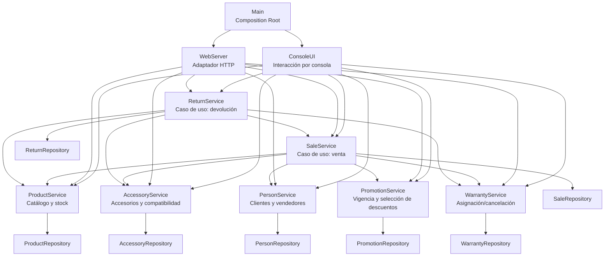

# Diagrama GRASP — responsabilidades integradas

Este diagrama refleja las responsabilidades de las capas de presentación, aplicación y persistencia. Es un mapa de colaboración, no un sustituto de las clases UML completas.

## Lectura GRASP
- **Controller:** los servicios de casos de uso coordinan venta y devolución.
- **Information Expert:** producto y accesorio administran sus existencias; Promotion delega el descuento en estrategias.
- **Pure Fabrication:** los repositorios aíslan el formato de persistencia.
- **Creator:** Main ensambla dependencias y los servicios crean entidades de sus operaciones.
- **Low Coupling:** los gateways limitan la dependencia de la venta respecto al catálogo y las personas.
- **High Cohesion:** cada servicio agrupa operaciones del mismo concepto de negocio.

## Riesgo de consistencia
Venta y devolución coordinan más de un repositorio. Los archivos separados no ofrecen una transacción ACID global; una futura persistencia transaccional o una compensación explícita debe diseñarse y probarse antes de uso productivo.
