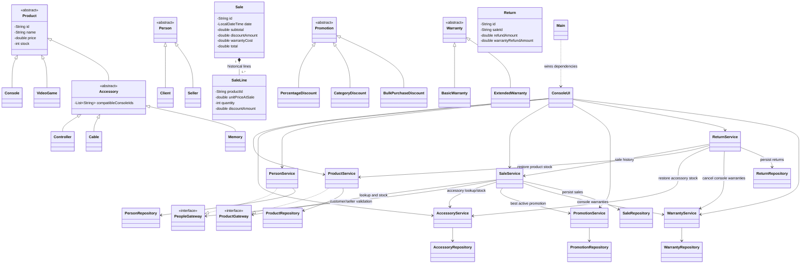

# Integrated Class Diagram

The diagram summarizes the domain hierarchy, service coordination, gateways, and persistence boundaries for Requirements 1–8. It is a high-level diagram; individual classes remain documented in their Java source files.

## Key design decisions

- Inheritance models product, person, promotion, and warranty variations.
- `SaleLine` preserves historical item prices and allocated discounts so later refunds do not depend on current catalogue prices.
- Services coordinate business workflows; repositories isolate storage; the UI delegates to services.
- Gateway interfaces reduce coupling between sale coordination and the product/people implementations.
