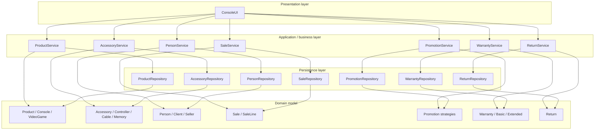

# Layer Architecture

The arrows show the allowed dependency direction. UI code delegates business decisions to services; services coordinate model objects and repository operations; repositories serialize or parse model data.

## Dependency rules

1. `ConsoleUI` contains interaction logic only; it does not implement promotion, refund, or inventory rules.
2. Business rules live in the relevant service/model classes.
3. Repositories own file I/O and do not display console prompts.
4. `SaleService` consumes `ProductGateway` and `PeopleGateway` contracts rather than depending on concrete repositories.
