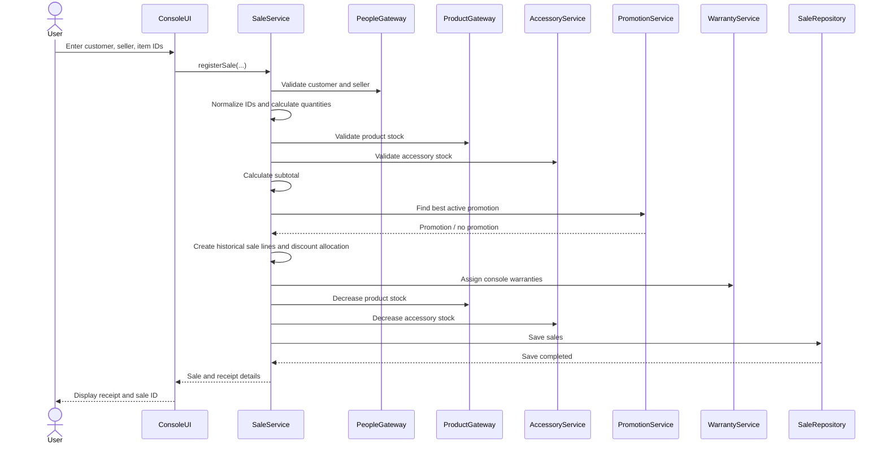
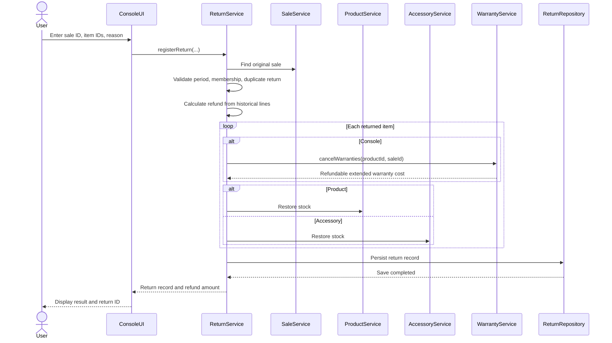

# Integrated Sequence Diagrams

## Register a sale

## Register a return

## Consistency note

These diagrams describe the intended happy path. The current file-based design writes to several separate files; those writes do not form one atomic transaction. Error-path testing and local demonstration are required before the system is treated as production-ready.
