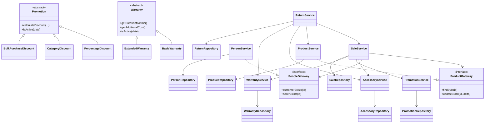

# Diagrama SOLID — estrategias y límites de dependencia

El siguiente diagrama destaca los puntos de extensión y las abstracciones de integración identificadas en el código. Las relaciones deben revisarse si el programador 1 cambia los contratos de accesorios.

## Lectura SOLID
- **SRP:** presentación, servicios de aplicación, dominio y persistencia se mantienen en módulos separados.
- **OCP:** las promociones y garantías se representan con jerarquías polimórficas.
- **LSP:** cada subtipo debe respetar el contrato de su abstracción; la aceptación requiere pruebas por subtipo.
- **ISP:** ProductGateway y PeopleGateway exponen contratos acotados a la integración de ventas.
- **DIP:** SaleService depende de gateways para productos y personas. Algunos servicios aún conocen servicios concretos y los repositorios dependen de archivos; es una simplificación aceptable para una demo local, no una arquitectura de producción plenamente desacoplada.

## Pendientes de verificación
- [ ] Pruebas de contrato de cada implementación de Promotion.
- [ ] Pruebas de contrato de BasicWarranty y ExtendedWarranty.
- [ ] Pruebas de integración de los gateways.
- [ ] Verificar que ningún controlador de UI acceda directamente a repositorios.
- [ ] Volver a generar el diagrama si cambian las firmas reales.
